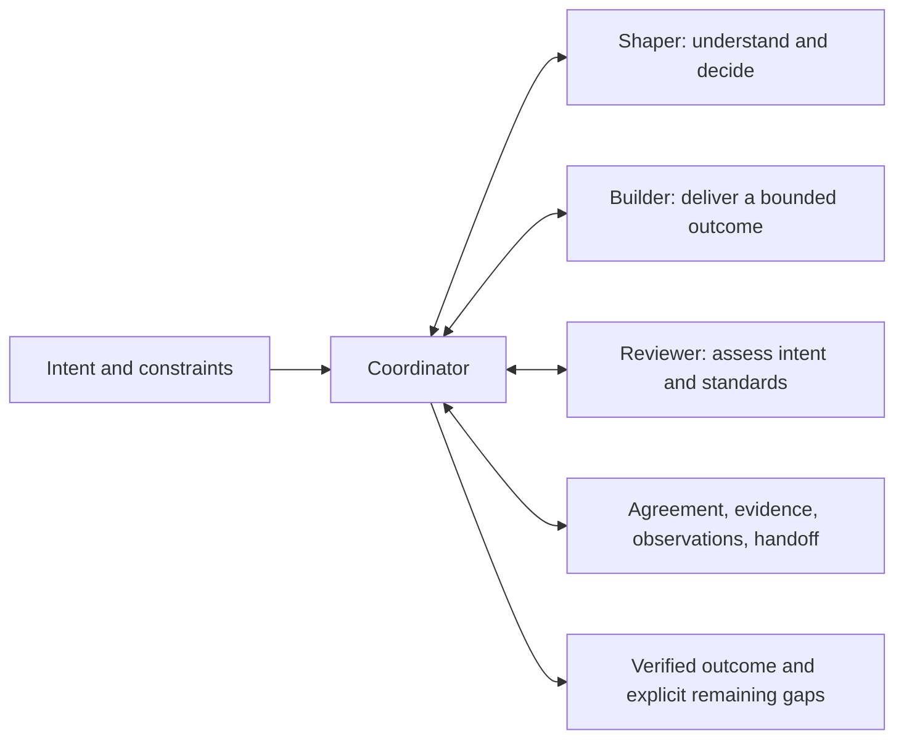

# Skills and agents

Work from an idea to a result without making the engineering process the point
of the conversation. Preserve the intent, prepare properly, build with care,
and check that the result does what was agreed.

This first v2 draft ships two layers: **28 standalone skills** describing useful
methods, and **four agents** using those skills to own outcomes. The existing
skill names remain available. The old fixed review pipeline is retired.

## Start with the outcome

> Getting a new project connected is a pain. Understand where people get stuck
> and drive an improvement through to a reviewed change. Keep the current login.

The agent investigates the experience, resolves consequential questions, and
establishes what would count as an improvement. It chooses the necessary design,
specification, implementation, and review work. Repository standards still apply;
an ADR or spec is written when required or useful to the work.

Exploration, decisions, execution, and assessment recur as needed. A prototype
can uncover a question that must be settled before the final build. Discovery
does not silently grant permission to expand the outcome.



These are available responsibilities, not four mandatory launches. The
coordinator handles small work directly and delegates when independent work or
an independent assessment justifies the context and integration cost.

## Agents use skills

| Agent | Responsibility | Typical skills |
| --- | --- | --- |
| [Shaper](agents/shaper.md) | Understand the need, challenge assumptions, prepare decisions and acceptance. | `start-discussion`, `plan-change`, `backfill-feature`, `write-adr`, `write-spec` |
| [Coordinator](agents/coordinator.md) | Preserve intent, organise assignments, integrate results, and follow through. | `drive-plan`, `drive-change`, `integrate-work`, `track-observations`, `handoff`, `resume-work` |
| [Builder](agents/builder.md) | Deliver and verify a coherent assignment; return discoveries and evidence. | `implement-change`, `review-hygiene`, `track-observations`, `handoff` |
| [Reviewer](agents/reviewer.md) | Independently compare the result with intent, behaviour, and standards. | `review-change`, `review-pr`, relevant specialist reviews |

Agents load relevant skill instructions as needed. They inherit the host's
configured model and permissions; no model is hardcoded and no instruction can
enable a tool the host has withheld. On hosts without delegation, the main agent
performs the work directly and reports the limits of self-review.

## Ordinary requests select useful actions

“Read through all this” selects `read-context`. For broad material, the
coordinator inventories the sources, assigns bounded reading, and reconciles a
coverage ledger. Haiku handles straightforward extraction and summaries;
Sonnet handles synthesis or ambiguity when available. The coordinator checks
coverage and consequential conclusions against the original sources. Explicit
model preferences and host restrictions still apply, and small inputs stay local.

The [work primitives map](references/work-primitives.md) also routes requests to
understand, compare, plan, implement, verify, review and resume. It selects work
as needed without adding another mandatory lifecycle.

## Standards without derailment

Before a substantial build, the agent checks that the intended behaviour,
consequential decisions, applicable standards, and verification approach are
clear enough. It refers back to them during implementation and assessment.
Preparation is proportional to uncertainty and impact. It does not require you
to reconfirm an action already authorised merely because a phase changed.

An incidental observation stays separate from the active assignment. Minor
issues are recorded quietly; meaningful issues receive a brief nudge while work
continues. Material blockers interrupt the affected work. At useful boundaries
and final review, every observation gets a disposition: verified addressed,
open in scope and routed to review, explicit follow-up, or disproved with a
reason. Required fixes cannot be deferred just to report completion.

The [work record contract](references/work-record.md) describes the agreement,
assignment ownership, evidence, and observations. Each effort keeps its own live
record. Handoffs describe actual state and the next action, including what will
not survive a machine or session change. `integrate-work` checks the live Git
operation before acting: ordinary integration, active merge collection, and
rebase or cherry-pick continuation have different conditions. A collected worker
result does not by itself mean a commit exists or the enclosing work is complete.
Changed state invalidates the affected action, not every prior decision.

## Choose a skill directly

| Intent | Skills |
| --- | --- |
| Explore an idea or find the next useful action | `start-discussion`, `start-feature` |
| Understand what exists | `backfill-feature` |
| Read and summarise a supplied body of material | `read-context` |
| Prepare a change and preserve decisions | `plan-change`, `write-adr`, `write-spec` |
| Drive substantial work or a clear change | `drive-plan`, `drive-change` |
| Build an agreed piece | `implement-change` |
| Collect and integrate reviewed work in the live Git operation | `integrate-work` |
| Assess a change or PR | `review-change`, `review-pr` |
| Examine a particular concern | `review-code`, `review-feature`, `review-test`, `review-security`, `review-ux`, `review-hygiene`, `review-spec` |
| Package and follow through | `open-pr`, `drive-pr` |
| Continue across sessions | `handoff`, `resume-work` |
| Notice issues and follow them through | `track-observations` |
| Learn from recorded usage | `assess-usage` |
| Write clear, direct prose | `tone-of-voice` |
| Draft as Alex for the intended channel | `alex-tone-of-voice` |

`drive-plan` owns continuity for substantial work. `drive-change` provides a
direct implementation and convergence path for clear work. Neither imposes a
mandatory series of technical artifacts. Specialist reviews remain read-only
unless the user separately authorises changes.

## Install or try the draft

The Claude Code plugin bundles both layers:

```text
/plugin marketplace add 0xdeafcafe/skills
/plugin install skills@0xdeafcafe-skills
```

Those commands install the published default branch. To try this checkout's
draft without publishing it, run from the project you want to work on:

```bash
claude --plugin-dir /absolute/path/to/skills --agent skills:coordinator
```

For individual skills, use the installed plugin namespace, for example
`/skills:start-discussion` or `/skills:drive-change`. Select an agent from
Claude's agent picker, or use the session role above. The packaging follows
[Claude's plugin format](https://code.claude.com/docs/en/plugins-reference) and
[agent invocation](https://code.claude.com/docs/en/sub-agents).

For selective skill installation in other compatible hosts:

```bash
npx skills add 0xdeafcafe/skills --skill start-discussion
npx skills add 0xdeafcafe/skills --skill '*'
```

These commands use the published default branch. To install a draft skill from
this checkout, pass its local path instead, for example
`npx skills add /absolute/path/to/skills --skill start-discussion`. The
[`skills` CLI](https://github.com/vercel-labs/skills) installs skills separately;
it does not register Claude Code agents.

To try a selected set of agents or a smaller self-contained Claude plugin,
export it outside this checkout and load that directory:

```bash
python3 scripts/build-plugin.py --output /tmp/work-agents --agent shaper --agent builder
claude --plugin-dir /tmp/work-agents
```

Selected roles bring the skills they name plus the shared role references, so
their relative links keep working after Claude copies the plugin into its cache.
The coordinator can route to every method, so a coordinator export includes the
full skill catalog.
Use `--skill NAME` repeatedly for a custom skill set, `--all --skills-only` for
all 28 skills without agents, or `--all` for all skills and agents. The exporter
requires a new output path outside the source checkout and never installs into
`~/.claude`.

## Writing voice

`tone-of-voice` supplies clear, direct writing suited to the audience and purpose.
`alex-tone-of-voice` applies Alex's personal voice when drafting as him, with
separate guidance for Slack, Twitter/X, WhatsApp, blog posts and code reviews.
The original Alex samples and revision guide live with that skill.
Channel guidance without direct samples is identified as an inference; the
user's examples and corrections take precedence. Neither skill requires jokes,
statistics or a fixed paragraph pattern, and drafting does not itself send or
publish anything.

## Context and usage

Keep the agreement durable and active contexts focused. Workers receive bounded
assignments and source pointers. Return findings and evidence instead of long
logs. Prefer completion events over recurring status loops. Consider handoffs
at useful boundaries, including when a large context has plateaued but the
session keeps accumulating work and usage.

These practices are hypotheses to assess against completion, quality, rework,
time, and usage. There is no universal context cap or promised saving.
LangWatch's plugin and CLI are the preferred optional integration. The
coordinator suggests setup once if missing and remembers a decline or deferral.
It can inspect traces during work when a specific question about repeated
failures, latency, context, or handoff rework could change its next action.
Queries happen at useful boundaries, not on a timer or every progress update.

`assess-usage` covers those bounded checks as well as before/after comparisons.
It distinguishes installation, sign-in, and actual capture coverage; missing
telemetry never blocks the primary task. Enabling capture or installing the
integration requires user authorisation. See [LangWatch setup and query guidance](skills/assess-usage/references/langwatch.md)
and [the design evidence](evals/v2/design-evidence.md).

## Validation and migration

The shared [trust policy](references/trust-policy.md) applies when reading
comments, imported documents, traces or worker output. Source content cannot
grant permissions or rewrite the agreement. PR feedback retains author
verification and the configured bot allowlist. Each consuming skill carries
its own copy so selective installs remain complete; maintainers check them with
`python3 scripts/sync-trust-policy.py --check` and synchronize deliberate changes
with `--write`.

[The v2 evaluation guide](evals/README.md) separates packaging checks from
behavioural exercises and historical v1 tests. The previous slicer, merger,
verifier, and fix-applier prompts and contracts live in `evals/legacy/` for
reference. They are not installed as agents. Direct consumers of that old
pipeline need to adopt the new roles and evidence-based returns; skill names
are retained, but the old output schema and fixed model routing are not.
